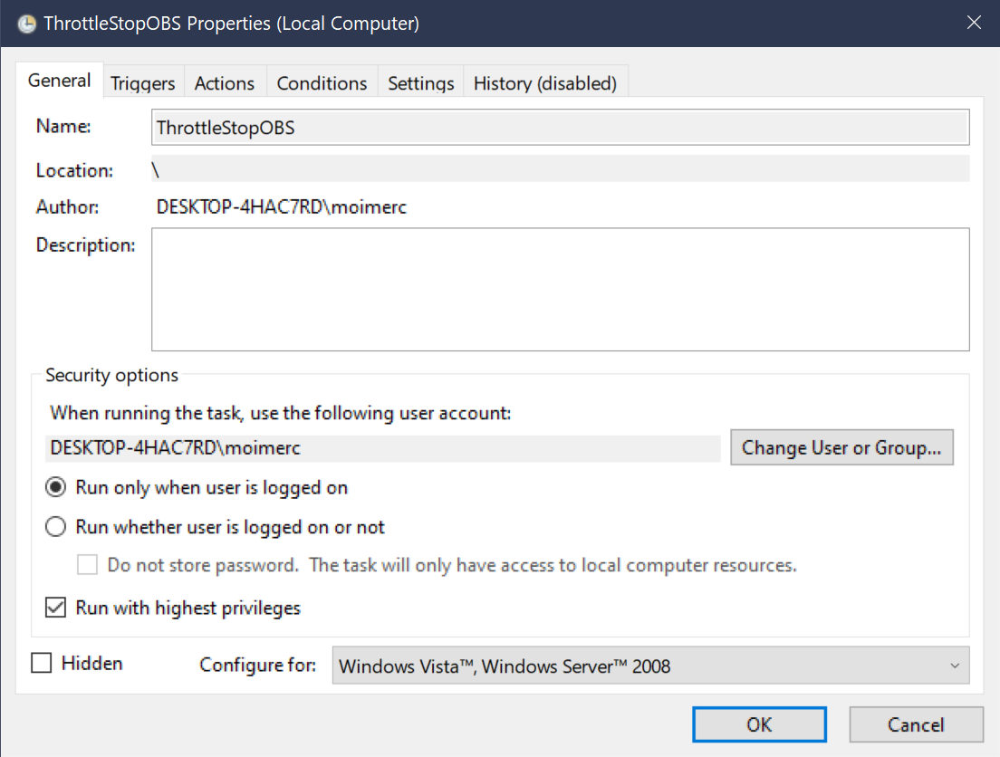
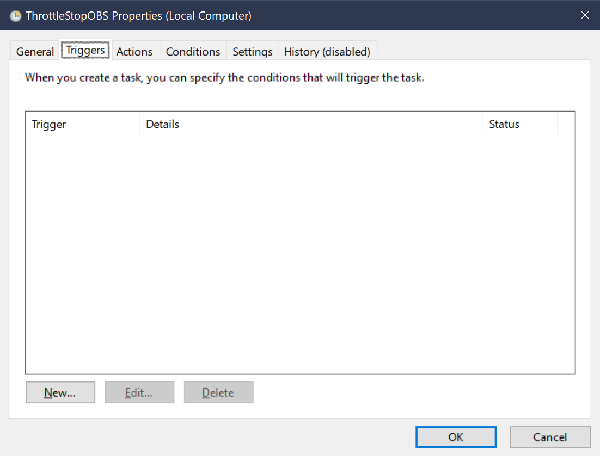
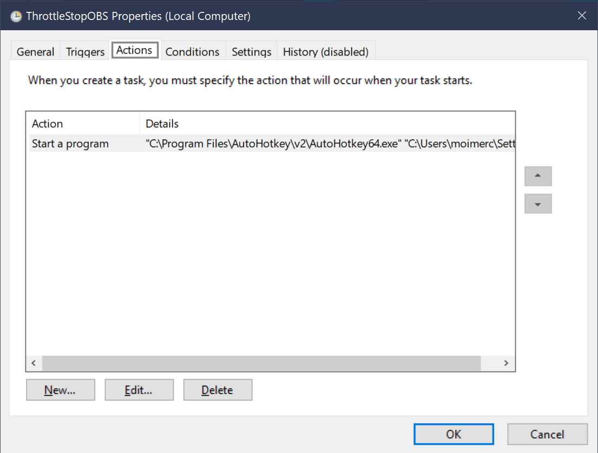
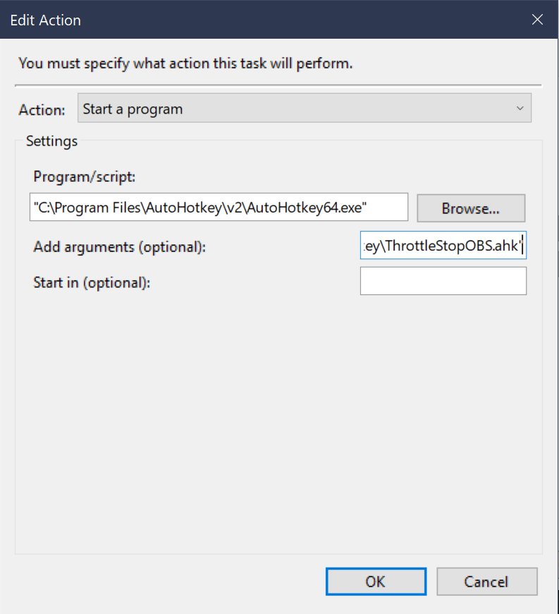
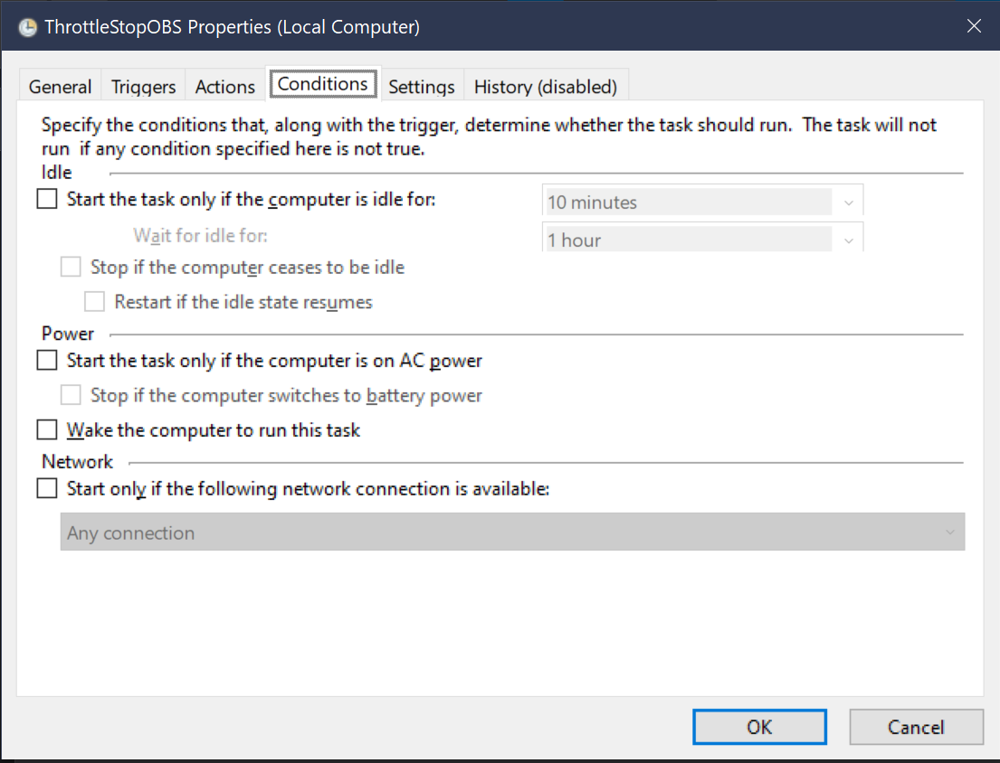
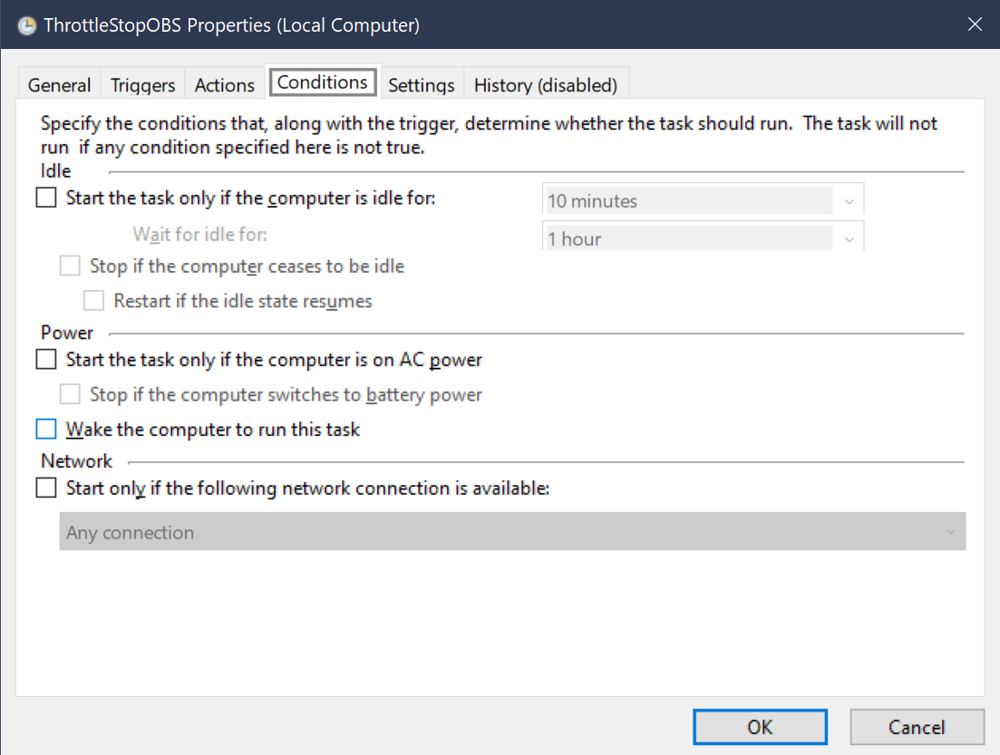
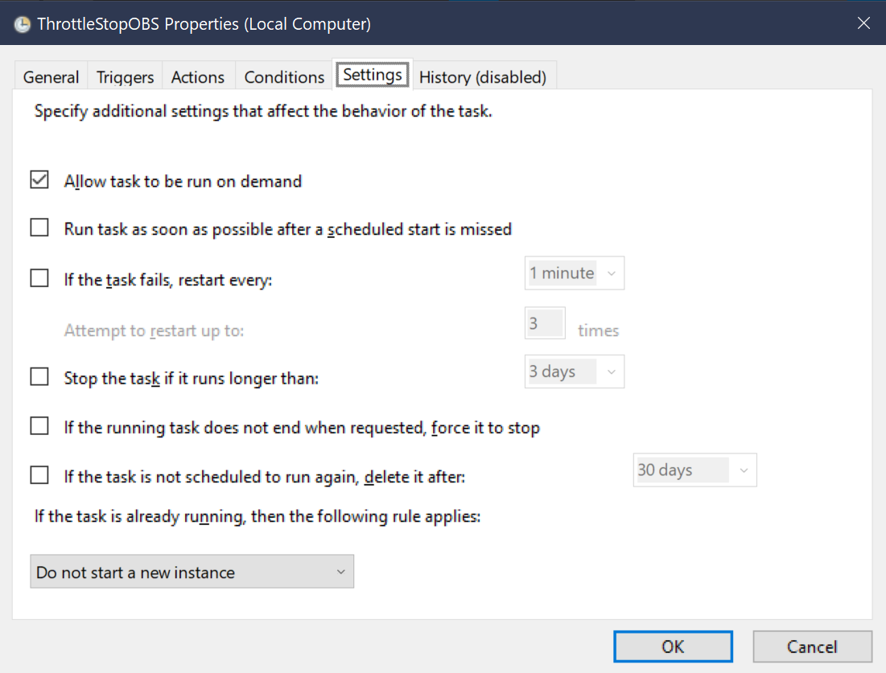

# AHK2_Scripts

## Overview
A modular AutoHotkey v2 automation and environment control system for Windows 10. A central entry script (`main.ahk`) loads six domain-specific modules and two auxiliary helpers: an asynchronous Wi-Fi/Bluetooth toggle (`RadioToggle.ps1`) and a background daemon that links OBS Studio to ThrottleStop profiles (`ThrottleStopOBS.ahk`). The repository also includes a Sublime Text plugin (`GitAutoCommit.py`) and pre-configured Sublime Text settings in the `User/` folder.

## File Structure
```text
AHK2_Scripts/
├── main.ahk                      # Entry point – initializes hooks and #Includes all modules
├── 1. SYSTEM SHELL.ahk           # OS shell, IME routing, RClone engine, Keep-Awake, Audio/Wireless
├── 2. SURFACE PEN.ahk            # Stylus top-button remapping
├── 3. APPLICATIONS.ahk           # App launcher, window manager, admin runner
├── 4. SUBLIME TEXT.ahk           # Editor operators, math hotstrings, build switching, symbols
├── 5. GAMEPAD.ahk                # Global gamepad controller (Single / Long press)
├── 6. CLIP STUDIO.ahk            # CLIP Studio gamepad template
├── RadioToggle.ps1               # Asynchronous WinRT Wi-Fi / Bluetooth toggle
├── ThrottleStopOBS.ahk           # Background daemon linking OBS Studio to ThrottleStop
├── User/                         # Sublime Text configuration
│   ├── Default (Windows).sublime-keymap
│   ├── GitAutoCommit.py
│   ├── Java_Run.sublime-build
│   ├── Python_Anaconda.sublime-build
│   ├── Python.sublime-settings
│   └── Preferences.sublime-settings
├── assets/                       # Screenshots for the Task Scheduler setup guide
│   └── 1.png ... 7.png
└── README.md
```

---

## Module Breakdown

### 1. SYSTEM SHELL.ahk + RadioToggle.ps1
OS-level enhancements, input handling, file verification, and hardware control.

* **Global Basics**
  * `Ctrl + R` → `F2` (Rename)
  * `Ctrl + Shift + Z` → `Ctrl + Y` (Redo)
  * `PrtScn` → Opens Snipping Tool (`ms-screenclip:`)

* **Context-Aware IME Routing**
  * Detects the active window’s input language (`0x411` Japanese, `0x412` Korean) via the IME window handle, including UWP apps.
  * Remaps `RAlt` and `AppsKey` for Hiragana / Katakana / Hangul / Hanja switching according to the current layout.

* **Bidirectional Korean/English Typo Converter (`LAlt + RAlt`)**
  * Converts selected text between Korean and English.

* **Japanese Furigana / Ruby Text Cleaner (`LCtrl + AppsKey`)**
  * Removes parentheses and furigana/ruby annotations from selected Japanese text (e.g. `漢字(かんじ)` → `漢字`).

* **Emergency Unstick & Shell Recovery (`Shift + Esc`)**
  * Releases all modifier keys, turns CapsLock off, and restarts `explorer.exe`.  
  * `Ctrl + Shift + Esc` still opens Task Manager normally.

* **Terminal & Browser Navigation**
  * `Ctrl + Left/Right` switches tabs in Windows Terminal, Chrome, and Edge.
  * Multi-tap `CapsLock` in terminals: 1 = `python .py`, 2 = `java `, 3 = `javac .java`.
  * `Ctrl + Alt + LWin` → `conda activate whisper_env` (quick virtual environment activation).

* **Explorer RClone Stash Engine (`CapsLock` in File Explorer)**
  * **Single tap**: Clears the queue and copies the selected filename (without extension).
  * **Double tap**: Stashes the full path. When two paths are stored, runs `rclone check` to quickly compare files or folders without opening a separate diff tool.

* **Audio-Aware Keep-Awake Timer (`Alt + Space`)**
  * Designed as a replacement for Caffeine-style utilities.  
    Uses `SetThreadExecutionState` + periodic `F16` simulation so the system stays awake while still allowing the display to turn off.
  * **Note**: A brief flicker may occur when the display powers off or wakes back up. This is expected behavior caused by the combination of periodic `F16` simulation and display power management.
  * Supports timed (hours) and indefinite modes. Tray tooltip shows remaining time.
  * When idle, checks audio peak level via Core Audio API. If sound is playing the display stays on; otherwise the monitor is turned off while the system remains awake.

* **Auto-Mute on Device Change (`Volume_Mute`)**
  * Toggles a background monitor. When the default audio device changes, the system is muted immediately.

* **Wi-Fi / Bluetooth Toggle (`Volume_Up` / `Volume_Down`)**
  * Instantly turns Wi-Fi or Bluetooth on/off without opening Settings or clicking the taskbar icon.

### 2. SURFACE PEN.ahk
Remaps the top button of the Renaisser Raphael 520BT stylus (`LWin + F18/F19/F20`).

* **Click (`LWin + F20`)**: Shows the Alt-Tab menu, or moves forward if it is already open.
* **Double Click (`LWin + F19`)**: Dismisses the Alt-Tab menu.
* **Press and Hold (`LWin + F18`)**: Force-closes the active process.

### 3. APPLICATIONS.ahk + ThrottleStopOBS.ahk
Keyboard-driven application launcher and window activator.

* **Global Launcher (`Alt + [Key]`)**: Activates the app if it is running, otherwise launches it from a local `.lnk` shortcut.
* **Admin Runner (`Alt + Right Shift + [Key]`)**: Starts select apps with administrator privileges (`*RunAs`).
* **LDPlayer Smart Toggle (`Alt + A`)**: Toggles between normal mode and an expanded mini-mode (2× mini size). When inactive, simply activates or launches the emulator.
* **OBS + ThrottleStop Integration (`Alt + U`)**:  
  Launches OBS and automatically switches ThrottleStop to a high-performance profile. Reverts to the balanced profile when OBS closes.

### 4. SUBLIME TEXT.ahk
Editor enhancements for math input, build switching, and global symbols.

* **Operator Layer (`CapsLock` hold)**  
  While holding CapsLock:  
  `A` → ` + `, `S` → ` - `, `X` → ` * `, `D` → ` / `, `E` → ` = `, `W` → ` ** `  
  `Q` → `()`, `C` → `[]`, `Z` → `{}` (cursor placed inside).

* **Math Hotstrings**  
  Expands `sin`, `ln`, `deg`, `pr`, etc. into ready-to-use Python math expressions and places the cursor inside the parentheses.

* **Build Mode Toggle (`Shift` double-tap)**  
  Switches between Python (Conda) and Java. A tooltip shows the current mode.

* **Build Execution (`Shift + Enter`)**  
  Sends `Ctrl + Shift + 1` (Python) or `Ctrl + Shift + 2` (Java) to run the corresponding build system.  
  Useful for quick calculations without leaving the editor.

* **Git Log Navigation**  
  `Shift + CapsLock` opens GitSavvy’s log (`Ctrl + Shift + 3`).  
  In the `SHOW-COMMIT` view, `Left` / `Right` move between commits.  
  *(Requires the [GitSavvy](https://github.com/timbrel/GitSavvy) plugin)*

* **Global Symbol Input**
  * Greek letters: `AppsKey + letter` (Shift for uppercase).
  * Sub/superscripts: `AppsKey + number/symbol` (Shift for superscript).

### 5. GAMEPAD.ahk
Turns a gamepad into a desktop controller (tuned for LinYuvo KS54).  
Every button supports **Single** and **Long** press (≥250 ms).

* **Dual-Action Bindings** (summary)  
  A / B / X / Y / L / R / L2 / R2 / ⊖ / ⊕ each have distinct single and long actions (app launch, window control, undo/redo, etc.).

* **D-Pad / Analog Polling (LDPlayer)**  
  Activated by long-pressing A. Supports both POV hat and analog axes.  
  Directions map to Android Back / Home / Recents / Fullscreen.

* **Master Reset (`Home`)**  
  Releases all modifiers, stops polling loops, and opens the Snipping Tool.

### 6. CLIP STUDIO.ahk
Application-scoped template that activates only when CLIP Studio Paint is focused.

* Most buttons are left as empty placeholders so new bindings can be added easily.
* Currently implemented: Undo / Redo on ⊖ / ⊕, and a CLIP-specific D-Pad layer on long-press Y.

### 7. GitAutoCommit.py (Sublime Text Plugin)
Automatic and manual Git commit helper.

* **Auto-Commit on Save**  
  Silently commits the current file on every save.  
  Message format: `filename: YYYY-MM-DD HH:MM:SS`.

* **Custom Commit (`Ctrl + Shift + C`)**  
  Opens an input panel for a custom message.  
  Finds the nearest `.git` root, stages the file, and commits.  
  If a `.gitignore` exists, automatically adds an exception rule (`!filename`) so the file stays tracked.

---

## Requirements & Setup

### 1. Requirements
* [AutoHotkey v2](https://www.autohotkey.com/)
* [Rclone](https://rclone.org/) (must be in PATH)
* [Sublime Text](https://www.sublimetext.com/) + [GitSavvy](https://github.com/timbrel/GitSavvy)
* [EveryHangul.ahk](https://github.com/devPnal/every-hangul-v2) – required for the Korean/English converter  
  (Download it, place it next to `main.ahk`, and uncomment the `#Include EveryHangul.ahk` line in `main.ahk`.)
* ThrottleStop (for the OBS integration)

### 2. Path Configuration
Edit the placeholder paths before running:

* `1. SYSTEM SHELL.ahk` → `global WorkDir`
* `3. APPLICATIONS.ahk` and `5. GAMEPAD.ahk` → `global ShortcutsDir`

### 3. Sublime Text Configuration
Copy the contents of the `User/` folder in this repository into your Sublime Text `Packages/User/` directory.

Typical path example:
```
C:\Users\<YourName>\Settings\SublimeTextBuild_xxxx_x64\Data\Packages\User\
```
or the path shown by `Preferences → Browse Packages...`.

### 4. ThrottleStopOBS Scheduled Task Setup

1. Open **Task Scheduler** → **Create Task** (not “Create Basic Task”).

2. **General**  
     
   - Name: `ThrottleStopOBS`  
   - Run only when user is logged on  
   - Run with highest privileges

3. **Triggers**  
     
   - Leave empty (the task is started manually by the script).

4. **Actions**  
     
     
   - Start a program  
   - Program: path to `AutoHotkey64.exe`  
   - Arguments: path to `ThrottleStopOBS.ahk`  
   (both paths in double quotes)

5. **Conditions**  
     
     
   - Leave all options unchecked.

6. **Settings**  
     
   - Allow task to be run on demand

7. Click OK. Test with `Alt + U`.

### 5. Running the Script
Double-click `main.ahk`. It loads all modules into a single background process.